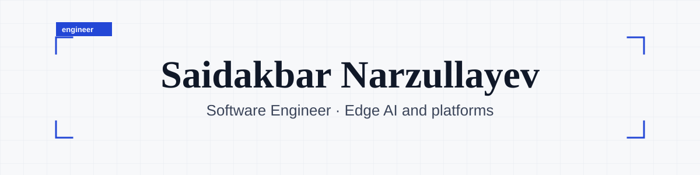
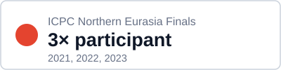
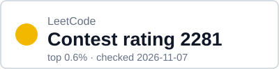
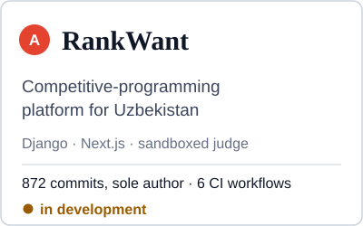
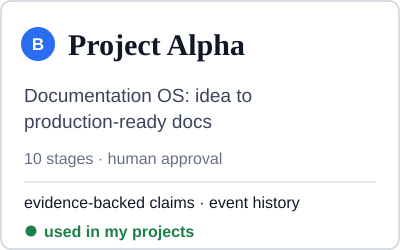
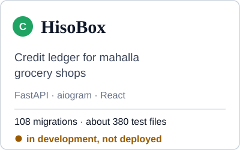

<picture><source media="(prefers-color-scheme: dark)" srcset="assets/banner-dark.svg"></picture>

I build edge-AI firmware and the platforms around it, and I study how to check what an AI agent reports as done.

<a href="https://nerc.itmo.ru/archive/2023/standings.html"><picture><source media="(prefers-color-scheme: dark)" srcset="assets/badge-icpc-dark.svg"></picture></a>
<a href="https://codeforces.com/profile/meNarzullayev"><picture><source media="(prefers-color-scheme: dark)" srcset="assets/badge-codeforces-dark.svg"></picture></a>
<a href="https://leetcode.com/u/NarzullayevMe/"><picture><source media="(prefers-color-scheme: dark)" srcset="assets/badge-leetcode-dark.svg"></picture></a>

<picture><source media="(prefers-color-scheme: dark)" srcset="assets/divider-dark.svg"></picture>

## Projects

<a href="https://github.com/menarzullayev/rankwant"><picture><source media="(prefers-color-scheme: dark)" srcset="assets/card-rankwant-dark.svg"></picture></a>
<a href="https://github.com/menarzullayev/project-alpha"><picture><source media="(prefers-color-scheme: dark)" srcset="assets/card-project-alpha-dark.svg"></picture></a>
<a href="https://github.com/menarzullayev/hisobox"><picture><source media="(prefers-color-scheme: dark)" srcset="assets/card-hisobox-dark.svg"></picture></a>

## Work

**TassVision**, firmware and AI models team: engineer since Dec 2025, after an internship (Sep – Nov 2025).
With a colleague I develop C++17 firmware for Ambarella CV25 smart cameras (detection, tracking, line-crossing events),
convert face-recognition models to the camera's binary format, and build fleet analytics in TypeScript.
This work is private; there is no public code.

## Research interest

How to verify what an AI agent reports as done, and how much autonomy to give it.

My first measurement is public: [agent-verification-study](https://github.com/menarzullayev/agent-verification-study). A verifier that sees a reply caught 36 of 36 injected errors, and the hypothesis that seeing the reply makes it miss more was not supported. The second comparison could not be interpreted because the blind verifier failed its own validity gate. The sample is small (12 per cell) and one model family does both jobs; the limits are on the first page.

## Tools

Python · TypeScript · C++17 · SQL · Django · FastAPI · aiogram · React and Next.js · PostgreSQL · Redis · ClickHouse · Docker · GitHub Actions · ONNX · Ambarella CNNGen

Ratings were checked on 2026-11-07 from the public APIs of both sites.
Contact: [LinkedIn](https://linkedin.com/in/NarzullayevMe)
