<picture><source media="(prefers-color-scheme: dark)" srcset="assets/hero-dark.svg"></picture>

[English](README.md) · [O‘zbekcha](README.uz.md) · [Русский](README.ru.md)

<picture><source media="(prefers-color-scheme: dark)" srcset="assets/worlds-dark.svg"></picture>

<picture><source media="(prefers-color-scheme: dark)" srcset="assets/flagships-dark.svg"></picture>

<picture><source media="(prefers-color-scheme: dark)" srcset="assets/stats-dark.svg"></picture>

<picture><source media="(prefers-color-scheme: dark)" srcset="assets/graph-dark.svg"></picture>

Interactive version: [menarzullayev.github.io](https://menarzullayev.github.io), a 3D project graph you can drag, filters, the same live numbers, and a plain-text view for agents. English, Uzbek and Russian. The same projects as a public board: [System map](https://github.com/users/menarzullayev/projects/3).

## Engineering

**TassVision**, firmware and AI models team: engineer since Dec 2025, after an internship (Sep to Nov 2025).
With a colleague I develop C++17 firmware for Ambarella CV25 smart cameras (detection, tracking, line-crossing events),
convert face-recognition models to the camera's binary format, and build fleet analytics in TypeScript.
About 1,950 devices were live in the 7 days before 2026-11-06 (counted from the fleet's request logs).
This work is private; there is no public code.

Public work, in development unless stated:

| Project | What it is |
|---|---|
| [rankwant](https://github.com/menarzullayev/rankwant) | Competitive-programming platform for Uzbekistan (Django, Next.js, sandboxed judge). About 1,000 commits as sole author. |
| [hisobox](https://github.com/menarzullayev/hisobox) | Credit ledger for mahalla grocery shops, via Telegram and web. Not deployed. |
| [project-alpha](https://github.com/menarzullayev/project-alpha) | Documentation OS: ten stages from a product idea to production-ready documents, with human approval and evidence-backed claims. |
| [tulporgo](https://github.com/menarzullayev/tulporgo) | Telegram taxi service for Uzbekistan: bot, Mini App, driver userbots. |
| [cpstands](https://github.com/menarzullayev/cpstands) | Live contest tracker for Telegram: standings, reminders, notifications (Codeforces, kep.uz). |
| [bot-platform](https://github.com/menarzullayev/bot-platform) | Multi-bot Telegram platform on Cloudflare Workers (TypeScript, grammY, D1). |

Five systems, including the private ones, are explained as decisions, measurements and what is not done in
[engineering-portfolio](https://github.com/menarzullayev/engineering-portfolio).

## Research

How to verify what an AI agent reports as done, and how much autonomy to give it.

My first measurement is public: [agent-verification-study](https://github.com/menarzullayev/agent-verification-study).
A verifier that sees a reply caught 36 of 36 injected errors, and the hypothesis that seeing the reply makes it miss
more was not supported. The second comparison could not be interpreted because the blind verifier failed its own
validity gate. The sample is small (12 per cell) and one model family does both jobs; the limits are on the first page.

## Competitive programming

[ICPC Northern Eurasia Finals](https://nerc.itmo.ru/archive/2023/standings.html): three times (2021, 2022, 2023) ·
[Codeforces](https://codeforces.com/profile/meNarzullayev): Candidate Master · [LeetCode](https://leetcode.com/u/NarzullayevMe/): contest rating 2281, top 0.6 percent.

## Tools

Python · TypeScript · C++17 · SQL · Django · FastAPI · aiogram · React and Next.js · PostgreSQL · Redis · ClickHouse · Docker · GitHub Actions · ONNX · Ambarella CNNGen

Contact: [LinkedIn](https://linkedin.com/in/NarzullayevMe)

The images above are drawn by [`scripts/build_profile.py`](scripts/build_profile.py) from public data (Codeforces and LeetCode APIs, the GitHub API) and rebuilt daily by [a workflow](.github/workflows/profile.yml). Private repositories are not counted. If a source is unreachable the last value is kept and marked with its date. What is counted and how: [DATA.md](DATA.md).
