<picture><source media="(prefers-color-scheme: dark)" srcset="assets/hero-dark.svg"></picture>

[English](README.md) · [O‘zbekcha](README.uz.md) · [Русский](README.ru.md)

<picture><source media="(prefers-color-scheme: dark)" srcset="assets/worlds-dark.svg"></picture>

<picture><source media="(prefers-color-scheme: dark)" srcset="assets/flagships-dark.svg"></picture>

<picture><source media="(prefers-color-scheme: dark)" srcset="assets/stats-dark.svg"></picture>

<picture><source media="(prefers-color-scheme: dark)" srcset="assets/graph-dark.svg"></picture>

Интерактивная версия: [menarzullayev.github.io](https://menarzullayev.github.io) — 3D-граф проектов, который можно перетаскивать, фильтры, те же живые цифры и текстовый режим для агентов. На английском, узбекском и русском. Те же проекты как открытая доска: [System map](https://github.com/users/menarzullayev/projects/3).

## Инженерия

**TassVision**, команда прошивок и ИИ-моделей: инженер с декабря 2025 года, до этого стажёр (сентябрь–ноябрь 2025).
Вместе с коллегой пишу прошивку на C++17 для умных камер Ambarella CV25 (детекция, трекинг, события пересечения линии),
конвертирую модели распознавания лиц в бинарный формат камеры и строю аналитику парка на TypeScript.
За 7 дней до 2026-11-06 было активно около 1 950 устройств (посчитано по журналу запросов парка).
Эта работа закрытая, открытого кода нет.

Открытые работы, в разработке, если не указано иное:

| Проект | Что это |
|---|---|
| [rankwant](https://github.com/menarzullayev/rankwant) | Платформа соревновательного программирования для Узбекистана (Django, Next.js, изолированная проверка решений). Около 1 000 коммитов, один автор. |
| [hisobox](https://github.com/menarzullayev/hisobox) | Кредитная книга для продуктовых магазинов махалли, через Telegram и веб. Не развёрнута. |
| [project-alpha](https://github.com/menarzullayev/project-alpha) | Documentation OS: десять этапов от идеи продукта до готовой документации, с одобрением человека и подтверждёнными утверждениями. |
| [tulporgo](https://github.com/menarzullayev/tulporgo) | Такси-сервис внутри Telegram для Узбекистана: бот, Mini App, юзерботы водителей. |
| [cpstands](https://github.com/menarzullayev/cpstands) | Трекер соревнований для Telegram: таблицы, напоминания, уведомления (Codeforces, kep.uz). |
| [bot-platform](https://github.com/menarzullayev/bot-platform) | Мульти-бот платформа Telegram на Cloudflare Workers (TypeScript, grammY, D1). |

Четыре из этих систем описаны через решения, измерения и то, что не сделано, в
[engineering-portfolio](https://github.com/menarzullayev/engineering-portfolio).

## Исследование

Как проверять то, что ИИ-агент сообщает как «готово», и сколько самостоятельности ему давать.

Первое моё измерение открыто: [agent-verification-study](https://github.com/menarzullayev/agent-verification-study).
Проверяющий, видевший ответ, поймал 36 из 36 внесённых ошибок; гипотеза о том, что вид ответа заставляет пропускать
больше ошибок, не подтвердилась. Второе сравнение нельзя интерпретировать, потому что слепой проверяющий не прошёл
собственный критерий валидности. Выборка маленькая (по 12 на ячейку), и обе роли выполняет одно семейство моделей; ограничения описаны на первой странице.

## Соревновательное программирование

[Финалы ICPC Северной Евразии](https://nerc.itmo.ru/archive/2023/standings.html): три раза (2021, 2022, 2023) ·
[Codeforces](https://codeforces.com/profile/meNarzullayev): Candidate Master · [LeetCode](https://leetcode.com/u/NarzullayevMe/): рейтинг соревнований 2281, топ 0.6 процента.

## Инструменты

Python · TypeScript · C++17 · SQL · Django · FastAPI · aiogram · React и Next.js · PostgreSQL · Redis · ClickHouse · Docker · GitHub Actions · ONNX · Ambarella CNNGen

Связь: [LinkedIn](https://linkedin.com/in/NarzullayevMe)

Изображения выше рисует [`scripts/build_profile.py`](scripts/build_profile.py) по открытым данным (API Codeforces и LeetCode, API GitHub), а [workflow](.github/workflows/profile.yml) пересобирает их ежедневно. Закрытые репозитории не учитываются; если источник недоступен, остаётся последнее значение с датой. Что и как считается: [DATA.md](DATA.md). Русский текст — черновик с машинной помощью; эталон — английский.
