<picture><source media="(prefers-color-scheme: dark)" srcset="assets/hero-dark.svg"></picture>

[English](README.md) · [O‘zbekcha](README.uz.md) · [Русский](README.ru.md)

<picture><source media="(prefers-color-scheme: dark)" srcset="assets/worlds-dark.svg"></picture>

<picture><source media="(prefers-color-scheme: dark)" srcset="assets/flagships-dark.svg"></picture>

<picture><source media="(prefers-color-scheme: dark)" srcset="assets/stats-dark.svg"></picture>

<picture><source media="(prefers-color-scheme: dark)" srcset="assets/graph-dark.svg"></picture>

Interaktiv versiya: [menarzullayev.github.io](https://menarzullayev.github.io) — sudrab aylantiriladigan 3D loyihalar grafi, filtrlar, xuddi shu jonli raqamlar va agentlar uchun oddiy matn ko‘rinishi. Ingliz, o‘zbek va rus tillarida. Xuddi shu loyihalar ochiq doska sifatida: [System map](https://github.com/users/menarzullayev/projects/3).

## Muhandislik

**TassVision**, firmware va AI modellari jamoasi: 2025-yil dekabridan muhandis, avval stajyor edim (2025-yil sentabrdan noyabrgacha).
Hamkasbim bilan Ambarella CV25 aqlli kameralari uchun C++17 firmware yozaman (aniqlash, kuzatuv, chiziqni kesib o‘tish hodisalari),
yuzni tanish modellarini kameraning ikkilik formatiga o‘tkazaman va TypeScript’da kameralar parki tahlilini quraman.
2026-11-06 gacha bo‘lgan 7 kunda taxminan 1 950 ta qurilma jonli edi (kameralar parkining so‘rov jurnalidan sanalgan).
Bu ish yopiq, ochiq kod yo‘q.

Ochiq ishlar (boshqacha aytilmasa, ishlab chiqilmoqda):

| Loyiha | Nima bu |
|---|---|
| [rankwant](https://github.com/menarzullayev/rankwant) | O‘zbekiston uchun dasturlash musobaqalari platformasi (Django, Next.js, sandbox’li sudya). Taxminan 1 000 commit, yakka muallif. |
| [hisobox](https://github.com/menarzullayev/hisobox) | Mahalla do‘konlari uchun nasiya daftari, Telegram va veb orqali. Joylashtirilmagan. |
| [project-alpha](https://github.com/menarzullayev/project-alpha) | Documentation OS: mahsulot g‘oyasidan ishlab chiqarishga tayyor hujjatlargacha o‘n bosqich, inson tasdig‘i va dalilga asoslangan da‘volar bilan. |
| [tulporgo](https://github.com/menarzullayev/tulporgo) | O‘zbekiston uchun Telegram’dagi taksi xizmati: bot, Mini App, haydovchi userbotlari. |
| [cpstands](https://github.com/menarzullayev/cpstands) | Telegram uchun jonli musobaqa kuzatuvchisi: reyting, eslatma, bildirishnomalar (Codeforces, kep.uz). |
| [bot-platform](https://github.com/menarzullayev/bot-platform) | Cloudflare Workers ustidagi ko‘p botli Telegram platformasi (TypeScript, grammY, D1). |

Shu tizimlardan to‘rttasi qarorlar, o‘lchovlar va bajarilmagan ishlar sifatida
[engineering-portfolio](https://github.com/menarzullayev/engineering-portfolio) da tushuntirilgan.

## Tadqiqot

AI agentning “bajarildi” degan hisobotini qanday tekshirish va unga qancha mustaqillik berish.

Birinchi o‘lchovim ochiq: [agent-verification-study](https://github.com/menarzullayev/agent-verification-study).
Javobni ko‘rgan tekshiruvchi kiritilgan 36 ta xatodan 36 tasini topdi; javobni ko‘rish ko‘proq xato o‘tkazib yuborishga
olib keladi degan gipoteza tasdiqlanmadi. Ikkinchi taqqoslashni sharhlab bo‘lmadi, chunki ko‘r tekshiruvchi o‘zining
yaroqlilik mezonidan o‘tmadi. Tanlama kichik (har katakda 12 ta) va ikkala vazifani bir model oilasi bajaradi; cheklovlar birinchi sahifada yozilgan.

## Musobaqa dasturlash

[ICPC Shimoliy Yevrosiyo finali](https://nerc.itmo.ru/archive/2023/standings.html): uch marta (2021, 2022, 2023) ·
[Codeforces](https://codeforces.com/profile/meNarzullayev): Candidate Master · [LeetCode](https://leetcode.com/u/NarzullayevMe/): musobaqa reytingi 2281, eng yaxshi 0.6 foiz.

## Vositalar

Python · TypeScript · C++17 · SQL · Django · FastAPI · aiogram · React va Next.js · PostgreSQL · Redis · ClickHouse · Docker · GitHub Actions · ONNX · Ambarella CNNGen

Aloqa: [LinkedIn](https://linkedin.com/in/NarzullayevMe)

Yuqoridagi rasmlarni [`scripts/build_profile.py`](scripts/build_profile.py) ochiq ma‘lumotdan (Codeforces va LeetCode API, GitHub API) chizadi va [workflow](.github/workflows/profile.yml) har kuni qayta quradi. Yopiq repozitoriylar hisobga olinmaydi; manba ishlamasa oxirgi qiymat sanasi bilan qoladi. Nima va qanday sanalishi: [DATA.md](DATA.md). Bu o‘zbekcha matn mashina yordamidagi qoralama; asosiy matn inglizcha.
